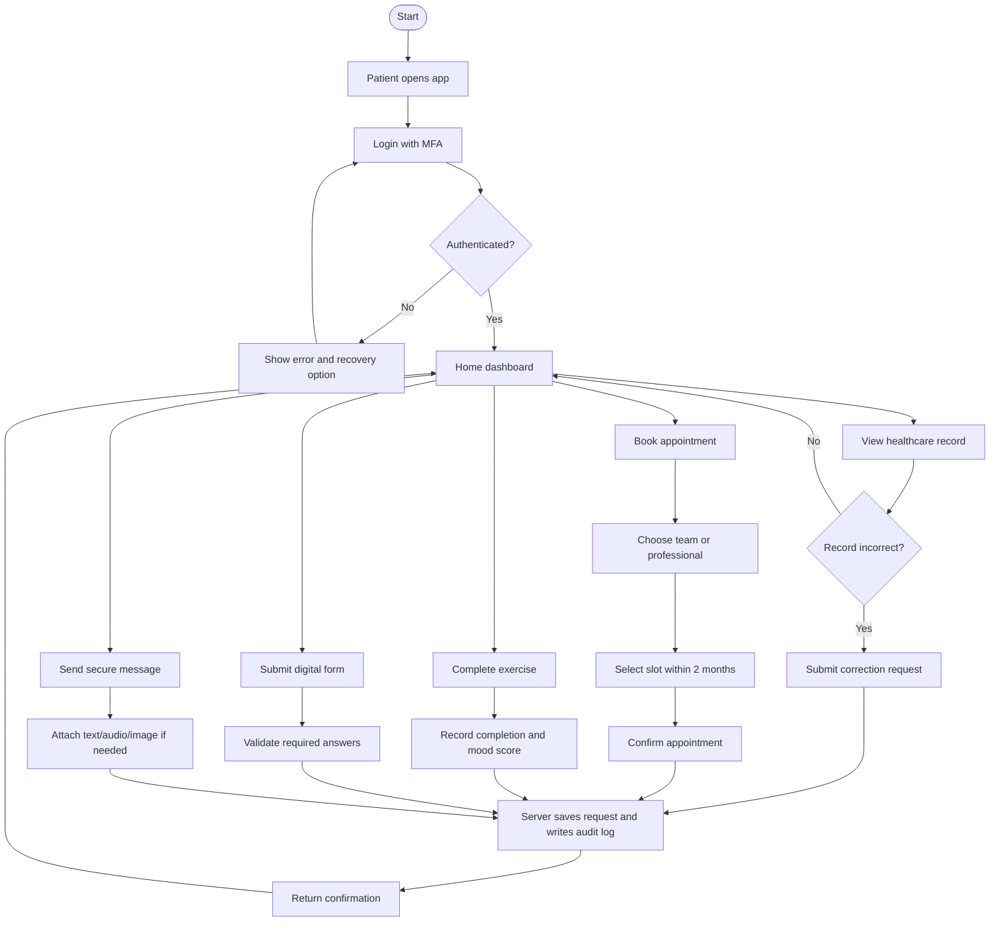
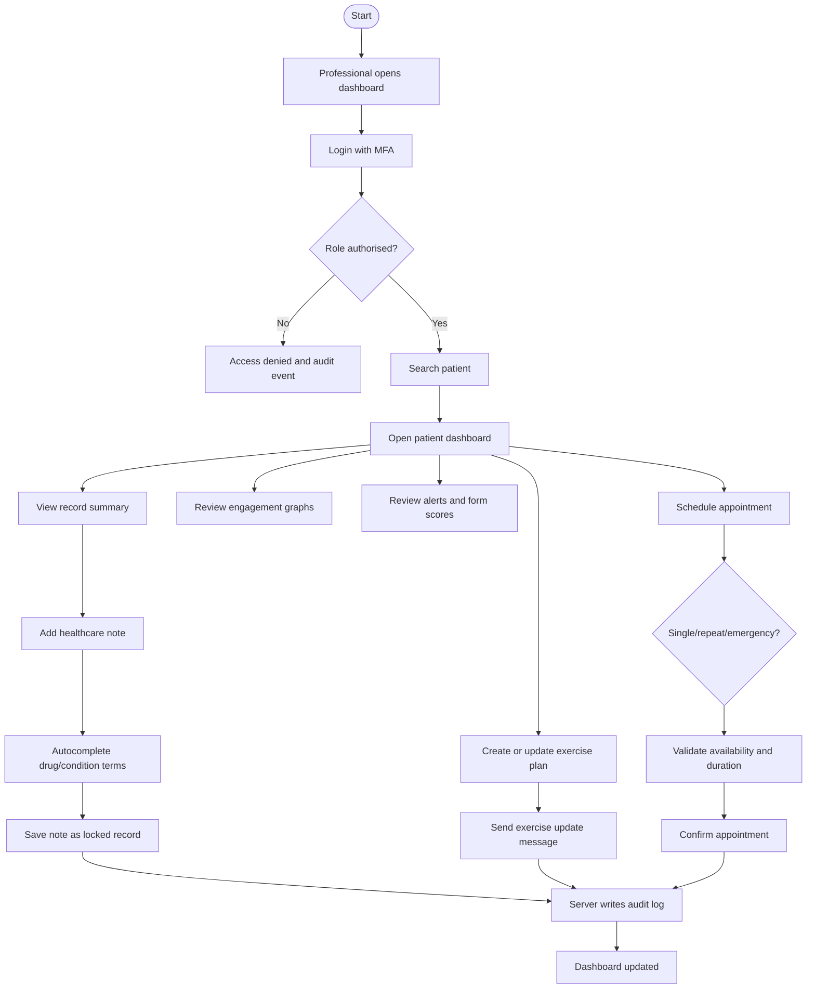
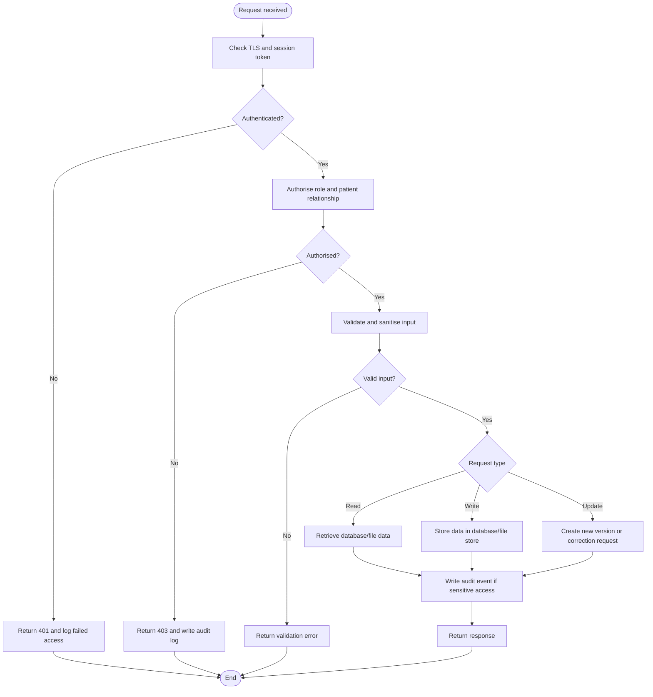
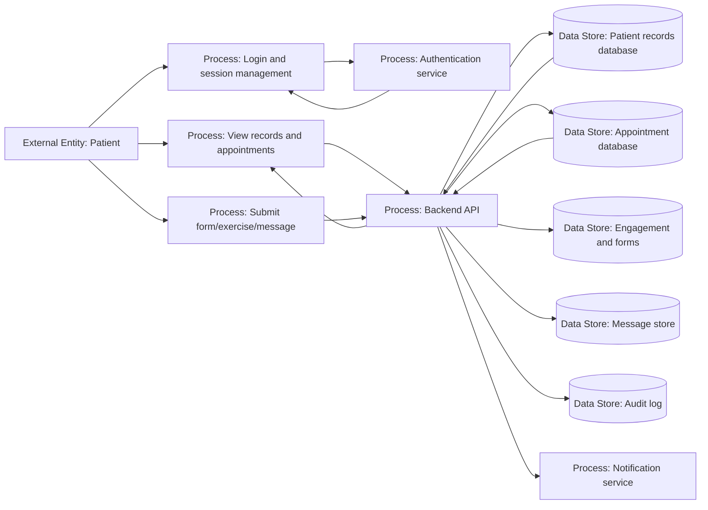
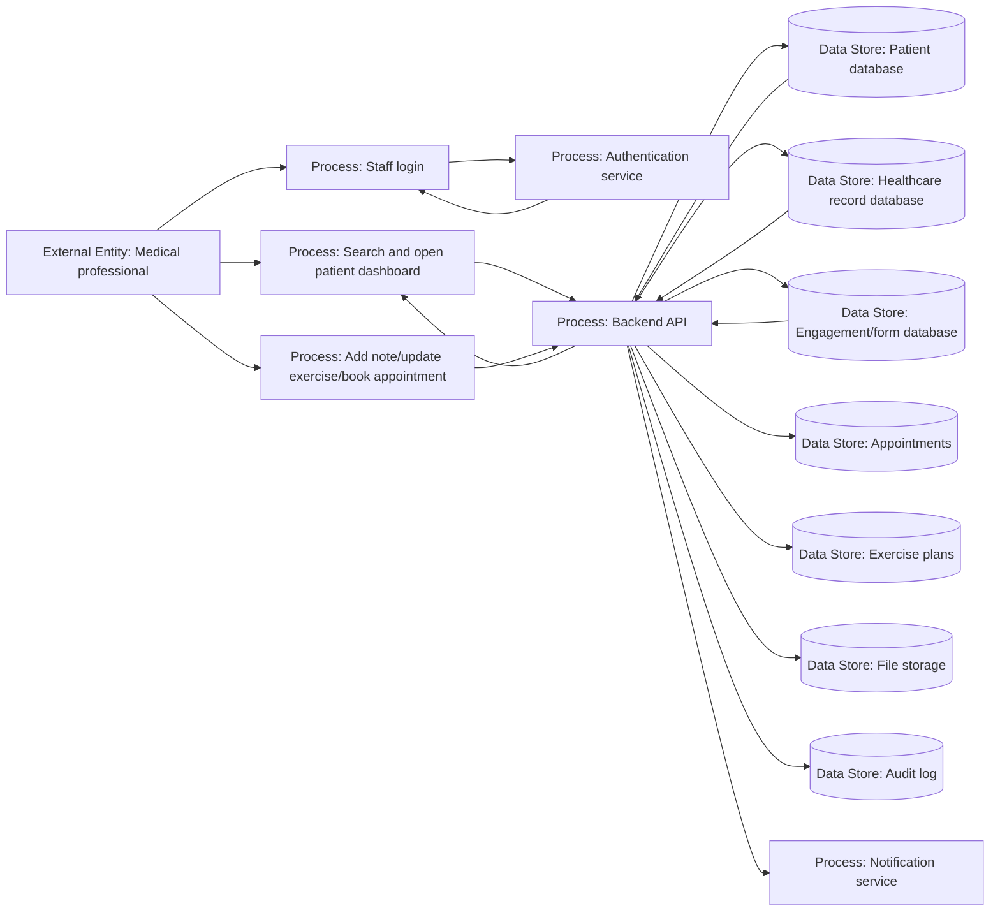
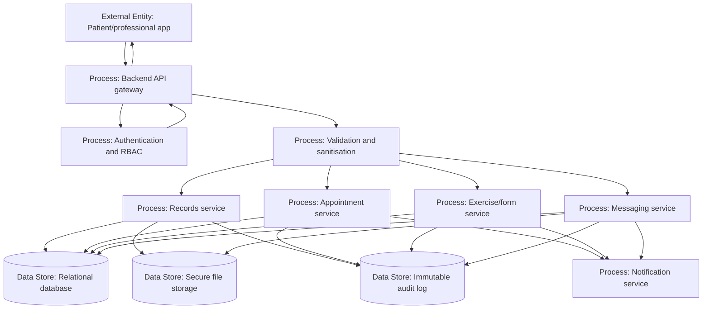
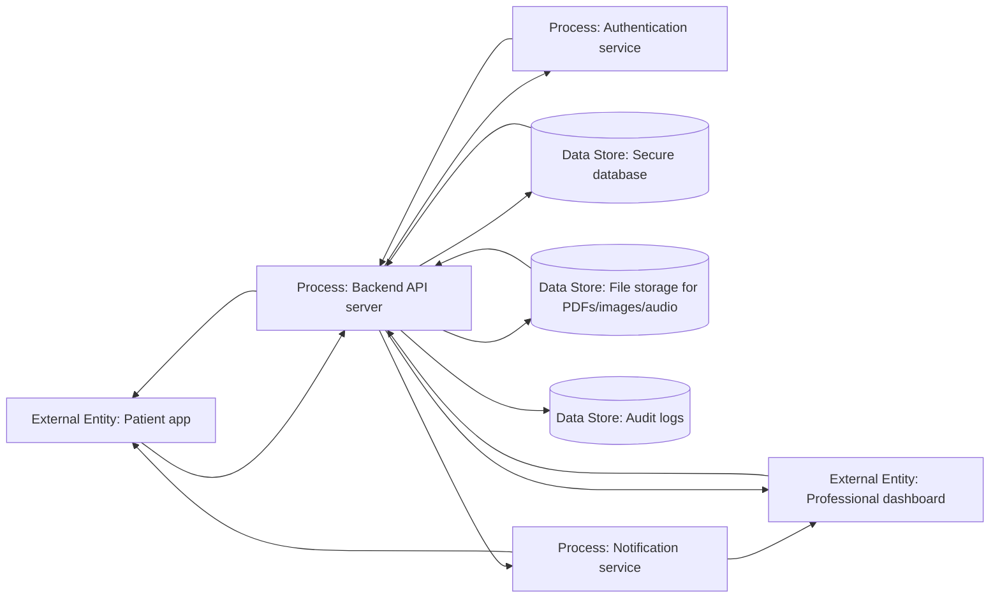
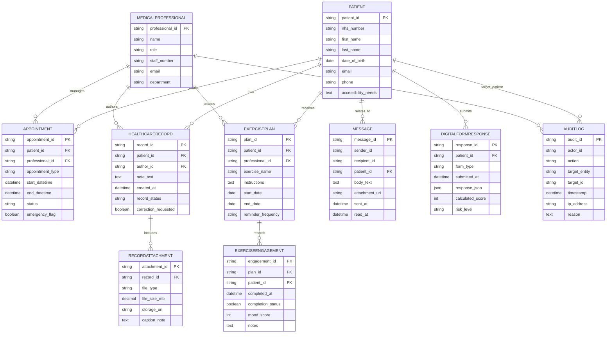

# Diagram source (Mermaid)

GitHub renders these diagrams directly. The same code is in the `diagrams/` folder as `.mmd` files.

## Figure 1 - Patient application workflow

## Figure 2 - Medical professional application workflow

## Figure 3 - Server-side workflow

## Figure 4 - Patient application dataflow

## Figure 5 - Medical professional application dataflow

## Figure 6 - Server-side dataflow

## Figure 7 - Overall system dataflow

## Figure 8 - Server-side ERD

